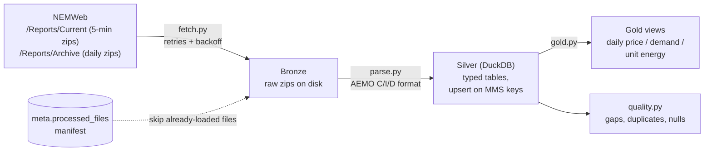

# nemweb-lakehouse

[](https://github.com/MAYPRABHU/nemweb-lakehouse/actions/workflows/ci.yml)

Incremental, idempotent ingestion of Australian electricity market data from
[AEMO's NEMWeb](https://nemweb.com.au/Reports/) into a local DuckDB lakehouse
(bronze → silver → gold), with data quality checks, tests and CI.

It runs on a laptop in a couple of minutes: no cloud account, no database server.

## Why this exists

The usual way to get NEM market data is a replicated copy of AEMO's MMS database. When that
feed goes down, trading and analytics teams lose visibility of 5-minute prices and dispatch.
This project is a **"shadow MMS" fallback**: it rebuilds the key MMS tables straight from the
public CSV files AEMO publishes on NEMWeb every 5 minutes.

> I originally built a version of this in a professional setting (Microsoft Fabric, Azure DevOps
> CI/CD, Power Automate alerting). This repo is a clean, open-source rebuild on public data
> only, redesigned to run anywhere.

## Architecture



| Layer  | What's there |
|--------|--------------|
| Bronze | Raw zip files exactly as downloaded (`data/bronze/<report>/`) |
| Silver | `silver.dispatch_price`, `silver.dispatch_regionsum`, `silver.dispatch_unit_scada` |
| Gold   | `gold.daily_region_price`, `gold.daily_region_demand`, `gold.daily_unit_energy` |
| Meta   | `meta.processed_files`: every source file loaded, when, and how many rows |

## Quickstart

Requires Python 3.10+.

```bash
git clone https://github.com/MAYPRABHU/nemweb-lakehouse.git
cd nemweb-lakehouse
python -m venv .venv
source .venv/bin/activate        # Windows: .venv\Scripts\activate
pip install -e ".[dev]"

nemweb run                       # latest hour of 5-min data (12 files per report)
nemweb backfill --start 2026-11-01 --end 2026-11-03   # whole days from the archive
nemweb check                     # data quality checks
nemweb summary                   # daily price stats per region
nemweb sql "SELECT * FROM gold.daily_unit_energy WHERE duid LIKE '%BESS%'"
```

Run `pytest` to run the test suite (no network needed).

## Design decisions

- **Idempotent by design.** Every loaded file is recorded in a manifest, and silver tables are
  upserted on the MMS natural keys (e.g. `SETTLEMENTDATE, RUNNO, REGIONID, DISPATCHINTERVAL,
  INTERVENTION`). Running the same thing twice never creates duplicates, and overlapping
  Current and Archive loads are safe.
- **Atomic per file.** All tables from one source file plus its manifest entry are written in a
  single transaction. A crash halfway through leaves nothing half-loaded.
- **Generic AEMO parser.** It handles the multi-table `C/I/D` record format, nested zips
  (Archive files are zips of zips), and table version changes mid-file.
- **Schema evolution.** When AEMO adds a column in a new table version, it's added to the
  silver table automatically instead of failing the load.
- **Numbers are always DOUBLE.** Type inference never picks integer, so a later file with a
  decimal in a "whole number" column can't corrupt or break the schema.
- **Fails loudly, keeps going.** A bad file is logged and skipped, the rest still load, and the
  CLI exits non-zero so a scheduler or CI can alert.
- **Testable without the internet.** Data sources share a tiny interface (`list_current`,
  `list_archive`, `get`), so tests and `--source-dir` replay from local folders.

## Data quality checks

| Check | Fails when |
|-------|-----------|
| `no_duplicate_keys[<table>]` | any natural key appears more than once |
| `price_interval_completeness` | any region is missing a 5-min price between the first and last loaded interval |
| `price_not_null` | any price (RRP) is null |

## Adding a table

Add it to a report in `src/nemweb/config.py` and give it keys in `TABLE_KEYS`.
For example, to add 30-min trading prices, add a `TradingIS_Reports` report with table
`TRADING_PRICE` keyed on `SETTLEMENTDATE, RUNNO, REGIONID, PERIODID`.

## Project layout

```
src/nemweb/
  config.py     reports, tables and natural keys
  fetch.py      NEMWeb HTTP source (+ local source), nested zip reader
  parse.py      AEMO multi-table CSV parser + type inference
  warehouse.py  DuckDB manifest, transactional upserts, schema evolution
  pipeline.py   incremental Current + Archive ingestion
  gold.py       analytics views
  quality.py    data quality checks
  cli.py        `nemweb` command
tests/          unit + end-to-end tests using generated NEMWeb-style zips
.github/        CI (lint + tests) and a weekly live smoke test against NEMWeb
```

## Limitations / next steps

- `/Reports/Archive` only covers recent months. Older history lives in AEMO's monthly MMSDM
  archive, which would be a separate loader.
- Days are calendar days by interval start, not the NEM 4am market day.
- Ideas: add PREDISPATCH price forecasts, export silver to partitioned Parquet, and put a
  dashboard on the gold layer.

## Data

Market data © AEMO, from the public NEMWeb site. See AEMO's
[copyright permissions](https://aemo.com.au/privacy-and-legal-notices/copyright-permissions).
